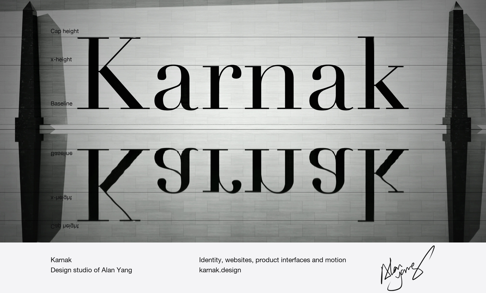

## Alan Yang

Founder and creative director of **[Karnak](https://karnak.design)**, a design studio for identity, websites, product interfaces and motion. 
Founder and CEO of **[MakeBook](https://makebook.xyz)**, on-chain escrow for preorders, incubated by Injective Ninja Labs. 
First prize, Injective track, AdventureX 2026.

 

## What we hold to

> **Sacred, in what you see.** 
> **Rational, in how it is made.** 
> **Everything is drawn to a system.**

Beauty held to the standard of an instrument: exact, quiet, built to last. Every commission answers to a single idea, and a detail that cannot say why it is there, goes.

The studio is named after the temple at Karnak, built over some two thousand years by about thirty pharaohs, each adding to what the last had left. That is the brief we set ourselves: an identity, a website, a product, each drawn so that the people who come after can keep building on it without breaking it.

 

## The problem we solve

A handsome page now costs a sentence. The question a brand should ask has moved from *does it look good* to *could anyone else have made it by lunchtime*. Three things survive that test, and they are what we build with.

**Material nobody else has.** The real archive, the real factory, the real number. RIMOWA told through the grooves of a 1919 airliner. Saridis through 2,500 years of one chair. Hasselblad through the photographs its cameras made on the Moon.

**A system exact enough that breaking it shows.** KMSWERK's sign is ≠, its stroke cut at 54.4°, and the same stroke is the arrow on every button.

**The decision about what to leave out.** The one step a machine is happy to skip.

 

## What we make

| | |
| :-- | :-- |
| **Identity** | Name, mark, type and colour, and the rules that hold them together |
| **Websites** | From the first idea to the live site, front-end included, designed for the phone as well as the desk |
| **Product interfaces** | Data, dashboards and flows for software, research and finance |
| **Art direction** | Archives, photography and one grade across every image |
| **Motion** | Scroll-driven scenes, films and launch trailers |

 

## Selected work

Every one of them is live. Concepts are marked as concepts; commissions as commissions.

| Work | | | |
| :-- | :-- | :-- | :-- |
| **KMSWERK** | Commission | Identity, website and product interface for a research tool that scores a product's design and its market separately. Across 718 products, design and outcome correlate at 0.14; the identity is built on that finding. With the KMSWERK team. | [Case](https://karnak.design/work/kmswerk) · [Live](https://kmswerk.com) |
| **MakeBook** | Founded | Pre-order and settlement on Injective. Buyers pay into escrow; a run goes ahead only if its minimum is met. | [Case](https://karnak.design/work/makebook) · [Live](https://makebook.xyz) |
| **SHOT ON** | Concept: Hasselblad | The Moon photographs first, the camera second. The focusing ring is the timeline, from the HK7 of 1941 to the X2D II. | [Case](https://karnak.design/work/shot-on) · [Live](https://shot-on.vercel.app) |
| **Die Koffer mit den Rillen** | Concept: RIMOWA | One surface, from the 1919 Junkers F 13 to the cases of today. Archive in silver, today in colour. Lighthouse 98 on a phone. | [Case](https://karnak.design/work/rimowa) · [Live](https://rimowa-concept.vercel.app) |
| **Saridis of Athens** | Concept: Saridis | Identity, website and shop for the workshop that has made the Klismos chair since 1961. | [Case](https://karnak.design/work/saridis) · [Live](https://saridis-concept.vercel.app) |
| **Templum Nº 01** | Studio edition | A website in four books of photography, from the ground to the sky, by 98 photographers held to one grade. | [Case](https://karnak.design/work/templum) · [Live](https://templum.space) |

 

## Record

| | | |
| :-- | :-- | :-- |
| **Karnak** | Founder and creative director | 2026 – |
| **MakeBook** | Founder and CEO · Injective Ninja Labs | 2026 – |
| **KMSWERK** | One of the lead designers: identity, website and product interface, with the KMSWERK team | 2026 |
| **Luvelia** | Founder · a Classic Lolita label, launched through preorders; MakeBook grew out of it | 2025 – |
| **AdventureX** | First prize, Injective track (Blockchain × AI), Hangzhou | 2026 |

 

## Thinking

**I. [Hard to copy](https://karnak.design/thinking/hard-to-copy).** Being able to make a thing is no longer scarce. Knowing which thing, and being willing to stop, is. 
**II. [You pay for the cut](https://karnak.design/thinking/you-pay-for-the-cut).** *Cento misure e un taglio solo.* A hundred measurements, and one cut. 
**III. [Specimen](https://karnak.design/thinking/specimen).** We say which is which, on every page, so that when we say a project was commissioned, you can believe it. 
**IV. [By correspondence only](https://karnak.design/thinking/by-correspondence).** A written brief forces the question most calls exist to avoid: what, exactly, do you want?

 

## Correspondence

By correspondence, in English or Chinese. Write what it is, what it must do, when it is due, and the budget.

New work [studio@karnak.design](mailto:studio@karnak.design) · Studios [partners@karnak.design](mailto:partners@karnak.design) · Press [press@karnak.design](mailto:press@karnak.design) 
[karnak.design](https://karnak.design) · [Behance](https://www.behance.net/0c583340)
